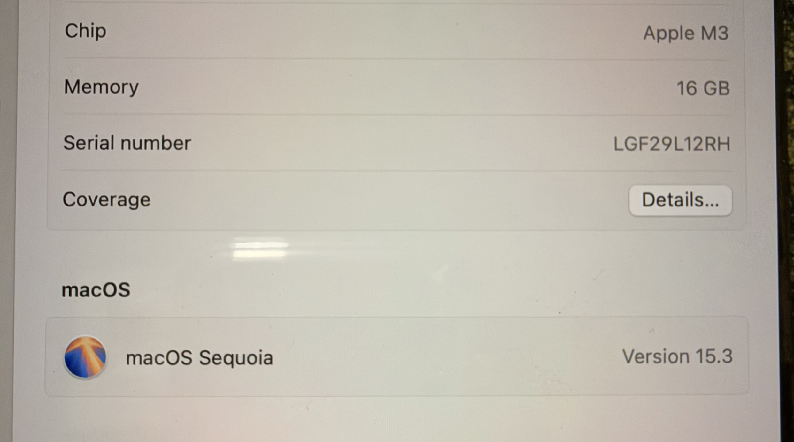

Day 5: Operating System Installation and Settings

Objective

To understand system information, Linux installation, macOS settings, Ubuntu user account creation, and Windows 10 installation.

Task 1: Windows System Information

Steps

1. Open the Start menu on a Windows computer.
2. Search for System Information.
3. Open the application.
4. Check the operating system version, processor, and installed RAM.
5. Take a screenshot showing these details.

Observations

* Operating System: [Enter your Windows version]
* Processor: [Enter your processor details]
* Installed RAM: [Enter your RAM details]

Evidence: Attach a screenshot of System Information.
Task 1: System Information Evidence (MacBook)

I am using a MacBook Pro instead of a Windows laptop or PC.

* Operating System: macOS Sequoia 15.3
* Processor: Apple M3
* Installed RAM: 16 GB

Evidence: Screenshot of macOS system information is provided. The Windows-specific screenshot could not be provided because I am using macOS.
Task 2: Create a Bootable Linux USB

Requirements

* An official Linux distribution ISO, such as Ubuntu.
* A USB drive with sufficient storage.
* Rufus or BalenaEtcher.

Steps

1. Visit the official Ubuntu website and download the Ubuntu ISO.
2. Download Rufus from its official website.
3. Insert a USB drive into the computer.
4. Open Rufus and select the USB drive.
5. Select the downloaded Ubuntu ISO file.
6. Choose the appropriate partition scheme and start the process.
7. Wait until Rufus finishes creating the bootable USB.

Important: Creating the bootable USB can erase its existing data. Back up important files first.

Result

The USB drive can be used to start the Ubuntu installation process.

Evidence: Attach a screenshot of Rufus showing the selected ISO or completed process.

Task 3: Change macOS Settings

Steps

1. Open System Settings on a Mac.
2. Open Wallpaper and select a different desktop wallpaper.
3. Open General and then Language & Region.
4. Add Hindi or Gujarati as a preferred language, or change the language setting as required.
5. Check that the settings have been applied.

Result

The desktop wallpaper and language preferences are updated.

Evidence: Attach screenshots of the changed wallpaper and language settings.

Task 4: Install Ubuntu and Create a User

Steps

1. Download the Ubuntu ISO from the official Ubuntu website.
2. Start the Ubuntu installer on a physical computer or in a virtual machine.
3. Follow the installation instructions.
4. Create a new user account with the username gamer.
5. Complete the installation and restart the system.
6. Enable automatic login for the gamer account using the available user settings.
7. Take a screenshot showing the account username or login screen.

Result

Ubuntu is installed, and the gamer user account is configured.

Evidence: Attach a screenshot showing the username and, if available, the automatic-login setting.

Task 5: Windows 10 Installation Guide

Requirements

* A compatible laptop or computer.
* Official Windows 10 installation media.
* A backup of important data.
* A valid Windows licence, where required.

Step-by-Step Installation

1. Back up important files before starting.
2. Download the Windows 10 installation media from Microsoft’s official website.
3. Create a bootable USB drive using the installation media tool.
4. Restart the computer and open the boot menu.
5. Select the USB drive to start Windows Setup.
6. Choose the language, time, and keyboard settings.
7. Select Install now.
8. Enter a product key if requested, or select the appropriate option to activate later if available.
9. Select the appropriate Windows edition and accept the licence terms.
10. Choose the installation type.
11. Review the drive partitions carefully. Select or create the intended Windows installation partition only after confirming that important data is backed up.
12. Continue the installation and allow the computer to restart.
13. Complete the initial setup, including the account, region, and network settings.
14. Open Windows Update and install available updates.
15. Review privacy settings and disable optional features you do not want.
16. Check Device Manager and install any missing drivers from the computer manufacturer’s official website.
17. Verify that Windows starts correctly and that essential hardware works.

Partitioning Tips

* Back up all important files before changing partitions.
* Identify the correct drive before deleting or formatting any partition.
* Do not delete recovery or data partitions unless you understand their purpose.
* Leave sufficient space for Windows, applications, and future updates.

Post-Installation Settings

* Install security updates.
* Review privacy and diagnostic-data settings.
* Check Windows activation.
* Install appropriate device drivers.
* Enable Windows Security and firewall protection.
* Create a recovery drive or another backup where appropriate.

Observation

This guide explains the main steps for installing Windows 10, managing partitions safely, and configuring the system after installation.

Conclusion

This assignment covers Windows system information, Linux bootable media, macOS customisation, Ubuntu user creation, and Windows installation procedures.
